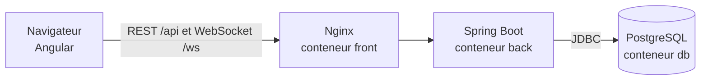

# Your Car Your Way – PoC du tchat de support client

Preuve de concept du **tchat entre un client et un conseiller** (epic 8 du cahier des charges). Elle montre que la stack
choisie dans la proposition d'architecture permet de le réaliser : Angular 22, Java 25 + Spring Boot 4.1,
PostgreSQL 18, WebSocket/STOMP, Docker. Ce n'est pas le produit final : ni réservation, ni paiement, ni inscription.

## 1. Lancer l'application

Prérequis : **Docker Desktop** (ou Docker Engine + Compose). Rien d'autre à installer.

```bash
git clone https://github.com/Bhahlou/your-car-your-way-chat-poc.git
cd your-car-your-way-chat-poc
docker compose up --build
```

La première fois, comptez quelques minutes. Quand `db`, `back` et `front` sont démarrés, ouvrez **http://localhost:4200**.
Pour arrêter : `Ctrl+C`, puis `docker compose down` (avec `-v` pour effacer aussi la base de données).

Comptes de démonstration (mot de passe commun : `Password123!`) :

| Rôle | Email |
|---|---|
| Client | `client1@example.com`, `client2@example.com` |
| Conseiller | `agent1@example.com`, `agent2@example.com` |

## 2. Tester le tchat

Ouvrez **deux onglets** (la session est propre à chaque onglet).

1. Onglet A : connectez-vous en `client1`, cliquez sur **Contacter le service client**, écrivez un message. La demande est « en attente ».
2. Onglet B : connectez-vous en `agent1`. La demande apparaît toute seule dans la file d'attente : cliquez sur **Prendre en charge**.
3. Échangez des messages dans les deux sens (le « … est en train d'écrire » s'affiche en direct).
4. Onglet B : **Clôturer la conversation**. Le client est prévenu ; la conversation reste consultable dans « Mes conversations ».

## 3. Comment c'est construit



- **REST** pour les actions ponctuelles (ouvrir, lister, prendre en charge, clôturer, historique).
- **WebSocket + STOMP** pour le temps réel (messages, « en train d'écrire », file d'attente). Le serveur envoie sans que le navigateur le redemande.
- **Un message est diffusé seulement après son enregistrement en base.**
- **Broker STOMP en mémoire** (Spring) : suffisant pour une instance. L'architecture prévoit RabbitMQ en production, pour plusieurs instances.
- **Flyway** crée le schéma de la base au démarrage (`backend/src/main/resources/db/migration`).

Le back est un **monolithe modulaire** avec deux modules, `accounts` (connexion, JWT) et `support` (le tchat).
Chaque module a trois couches : contrôleur (valide), service (règles métier), repository (base de données).
Le test `ModularityTests` échoue si `support` utilise autre chose que `AccountService` dans `accounts`.

```
backend/    Java : accounts/ et support/ (domain, repository, service, web, config)
frontend/   Angular : core/auth (connexion), features/support (client, conseiller, composant de conversation)
docker-compose.yml   db + back + front
```

Sécurité : mots de passe en Argon2id, JWT de 15 minutes, chaque abonnement WebSocket est contrôlé (un client n'écoute que
ses conversations), messages traités comme du texte brut. Aucun secret en dur : les valeurs de développement viennent de
`.env.example` (copiez-le en `.env` pour les changer).

## 4. Tests

| Quoi | Commande |
|---|---|
| Back (Docker doit tourner : Testcontainers lance un vrai PostgreSQL) | `cd backend && ./mvnw verify` |
| Front | `cd frontend && npx ng test --watch=false` |

La CI (GitHub Actions) exécute ces tests et le build du front à chaque pull request.

## 5. Limites de la PoC

Pas d'inscription, de refresh token, de fiche client pour le conseiller, d'internationalisation ni de RabbitMQ.
Seul le tchat est réalisé.

## 6. Problèmes fréquents

| Symptôme | Solution |
|---|---|
| `port is already allocated` | Un autre programme utilise le port 4200 : arrêtez-le, ou `docker compose down` |
| Les tests du back échouent (Docker / Testcontainers) | Démarrez Docker Desktop |
| `401` après un moment | Le JWT a expiré (15 min) : reconnectez-vous |
| Repartir d'une base vide | `docker compose down -v` |
| Windows : `./mvnw` introuvable | Dans PowerShell, écrivez `.\mvnw` |
